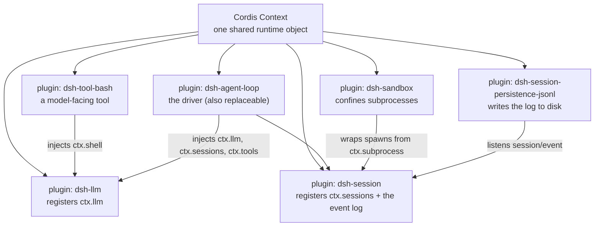
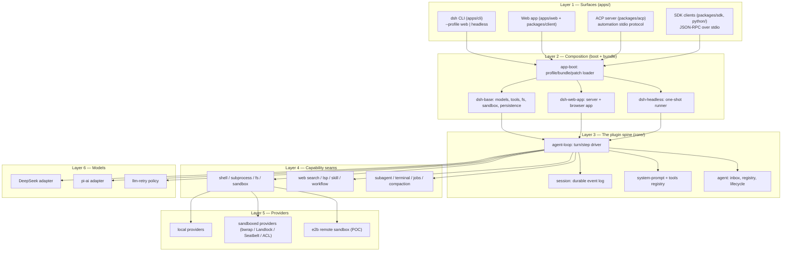
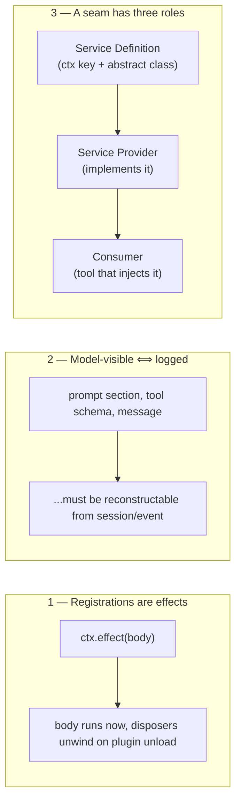

# 01 — The Big Picture

DeepSeek Harness (dsh) is a **plugin-based agent harness**: a runtime that composes an LLM agent from swappable pieces — model adapters, tools, filesystem, sandbox, persistence, UI — where every piece is a plugin on a vendored copy of the [Cordis](https://github.com/cordisjs/cordis) framework.

## Why "everything is a plugin"

There is **no privileged core**. The agent loop itself is a plugin that can be replaced from configuration. All behavior attaches to documented extension points (events and services); removing a plugin unwinds its contributions.

Implications that shape the whole codebase:

1. **Registrations are effects.** Every contribution goes through `ctx.effect()` / `ctx.on()`; a registry's `register()` returns a disposer. Unload a plugin and its services, events, and tools disappear cleanly.
2. **Composition happens at boot** from YAML (`cordis.yml`/`cordis.patch.yml`), not in code — see [03-composition-and-boot.md](03-composition-and-boot.md).
3. **Model-visible ⟺ logged.** Anything the model can see is reconstructable from the session log, and a runtime invariant asserts it — see [05-session-log.md](05-session-log.md).

## The layered map

The vertical arrow shows the key property: **the loop only talks to seams**, never to concrete providers. Swapping the provider behind `ctx.shell` or `ctx.fs` changes how bash, PTY, and LSP behave everywhere, with no changes to the loop.

## The three core invariants that everything else follows

## Where the code lives

| Concern | Location |
|---|---|
| The plugin runtime | `vendor/` (Cordis, rescopped to `@deepseek-ai/cordis`) |
| Product spine | `packages/core/` |
| Swappable capabilities | `packages/<seam>/` one group per seam |
| Durable session data | `packages/session/` |
| Remote/typed RPC | `packages/api/`, `packages/typert/`, `packages/sdk/` |
| Browser app | `packages/host/` + `packages/client/` |
| Shipped composition | `packages/bundle/`, `packages/examples/`, `examples/` |
| Python SDK | `python/` (SDK + bundled runtime, JSON-RPC stdio) |
| Native launcher | `native/landlock-run/` (Landlock self-restrict-then-exec) |

Next: [02-cordis-foundation.md](02-cordis-foundation.md) explains the framework mechanics everything rides on.
