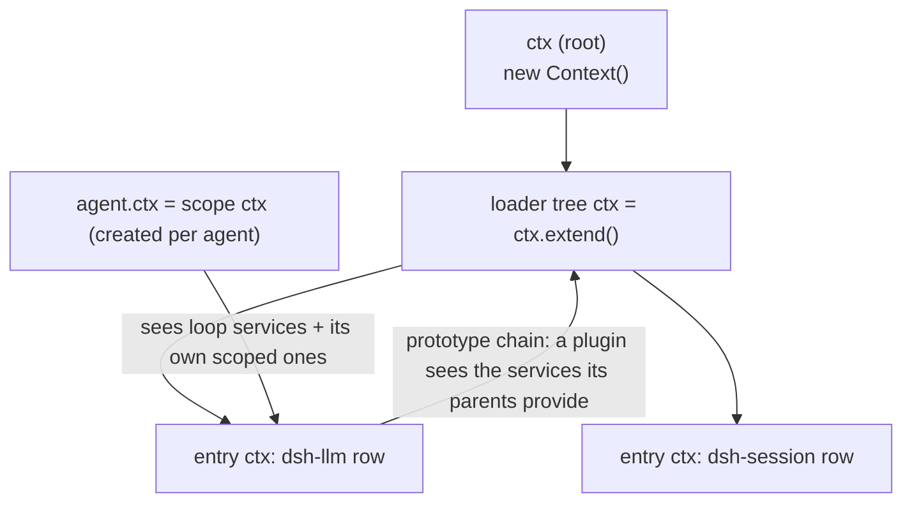
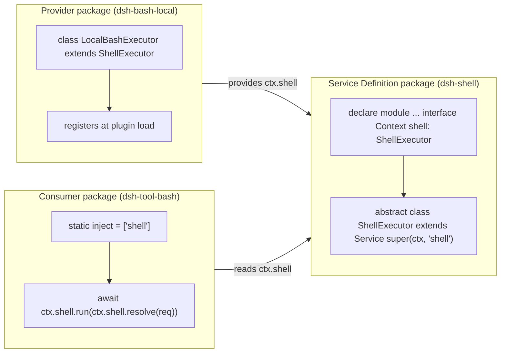
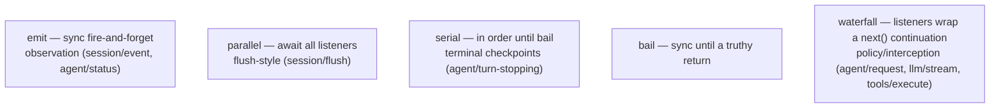
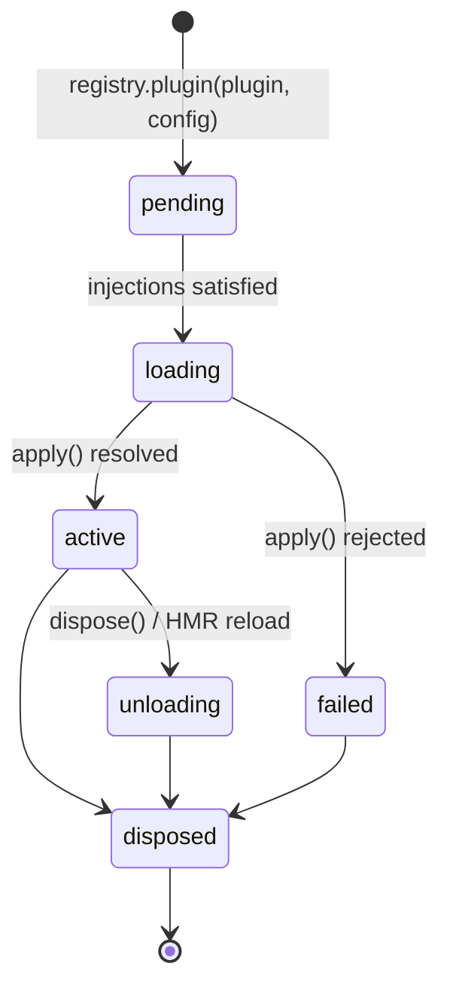
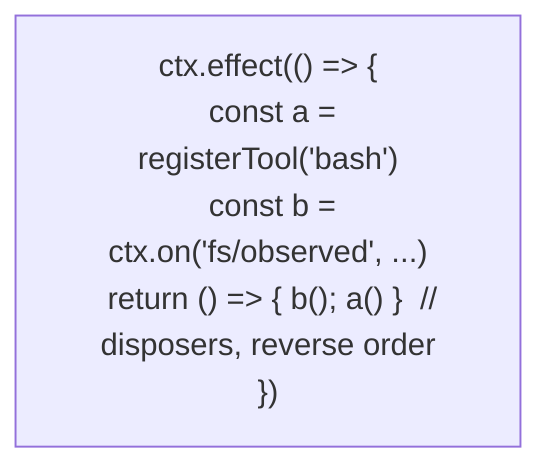
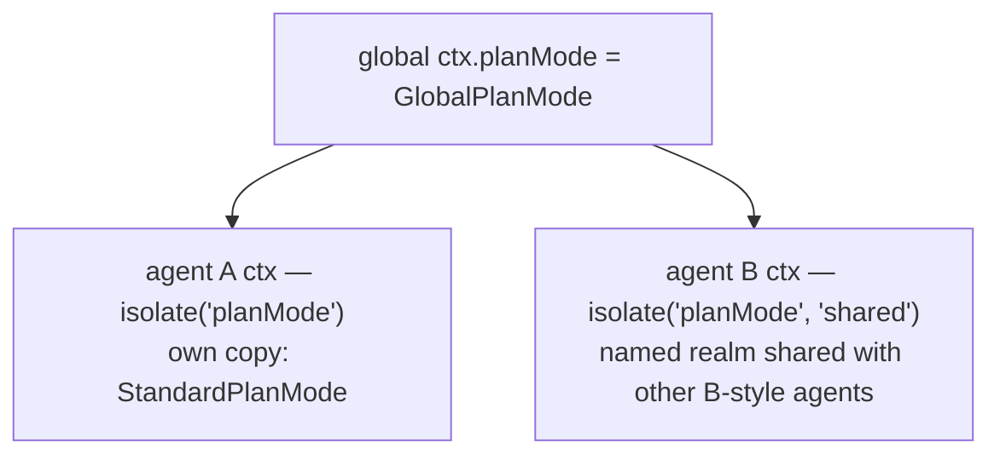

# 02 — The Cordis Foundation

dsh runs on a **vendored** copy of Cordis (`vendor/cordis/src/`). Understanding its four primitives — Context, Service, Events, Effects — explains almost every design decision in the repo.

## Context: a runtime proxy with a prototype chain

A `Context` is a Proxy whose property reads resolve through its prototype chain. `ctx.extend()` makes a child; the root is `ctx.root`. `ctx.get('llm')` reads a service; `ctx.baseUrl` anchors module resolution (`vendor/cordis/src/context.ts:71`).



## Services: declaration merging, registration on construction

A **Service** is a class that registers itself under a key in its constructor: `super(ctx, 'shell')`. TypeScript declaration merging on `Context` gives every consumer `ctx.shell` typing. `[Service.init]` is the post-construction lifecycle hook (`vendor/cordis/src/service.ts:42`).



`inject: ['shell']` makes the plugin **wait** until that service exists — activation is service-availability driven, not row-order driven. Row order in the config file carries no load semantics.

## Events: five dispatch modes

`vendor/cordis/src/events.ts:32` — every extension point in dsh is one of these:



The **waterfall contract** is the critical one (`vendor/cordis/src/events.ts:224`):

```mermaid
sequenceDiagram
    participant D as Dispatch (ctx.waterfall)
    participant L1 as Listener 1 (telemetry)
    participant L2 as Listener 2 (retry policy)
    participant END as Default handler (the real work)
    D->>L1: event(args, next)
    L1->>L2: next() — delegate
    L2->>END: next() — delegate
    END-->>L2: result
    L2-->>L1: result
    L1-->>D: result
    Note over L2: returning WITHOUT calling next()<br/>short-circuits the chain — that listener owns the decision
```

dsh leans on this everywhere: `agent/pre-step` decides what the model sees, `fs/write-intent` decides the freshness policy, `agent/request-error` decides retry.

## Fibers and effects: lifecycle with automatic unwinding

Each plugin mount is a **Fiber** with states `PENDING → LOADING → ACTIVE → DISPOSED` (plus `FAILED`/`UNLOADING`). `ctx.effect(body)` runs the body immediately, collects any disposers it produces, and runs them **in reverse order** when the fiber unloads (`vendor/cordis/src/fiber.ts:415`).





This is why "registrations are effects": HMR, `--patch` changes, and agent-preset isolation all just dispose fibers and re-run them.

## Isolated realms: private copies of a service

`ctx.isolate(name, label?)` gives a child context its own implementation of a service without touching the parent (`vendor/cordis/src/context.ts:121`). Used by agent presets: a session can run a **private** `planMode`, `compaction`, or tool set that shadows the global one.



## The Loader: config rows become plugins

The loader (`vendor/loader/src/`) turns YAML rows into mounted plugins:

- Each row = `{ id, name, config }`; `Entry.init()` imports the module, interpolates `!!js` expressions in `config` (deferred until the row's declared `inject`ions are active, so `!!js ctx.webStartup.host` sees the real service), and starts the fiber.
- A row may `inject` services, `intercept` (per-service config overlay), or `isolate` (realm swap).
- `Entry.update()` diffs row changes and picks in-place patch, restart, or dispose — each failure path rolls back (`vendor/loader/src/config/entry.ts:142`).
- `cordis:group` mounts nested row groups (`vendor/loader/src/config/group.ts:116`).

Next: [03-composition-and-boot.md](03-composition-and-boot.md) shows how profiles and bundles assemble these rows into a running app.
