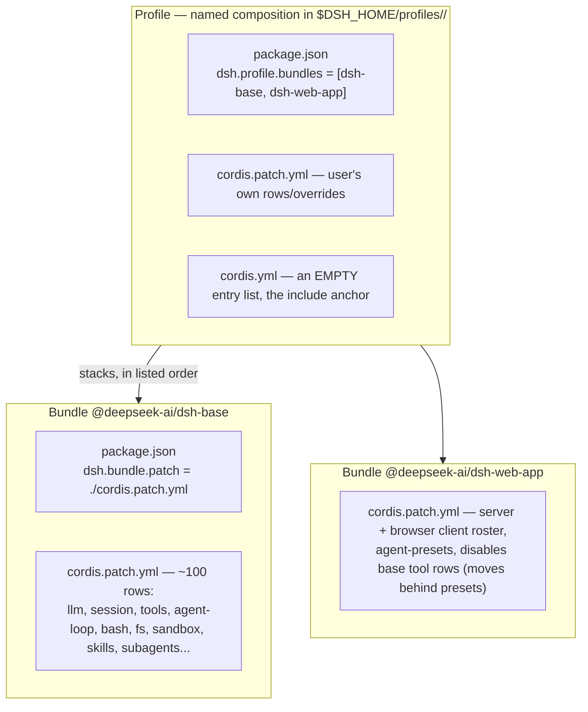
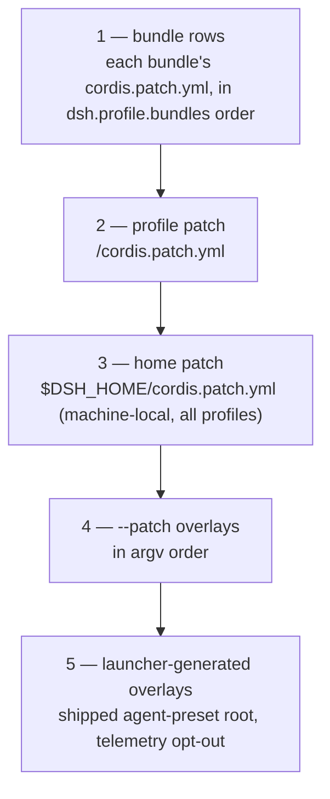
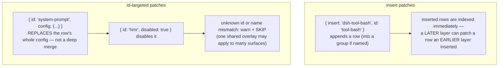
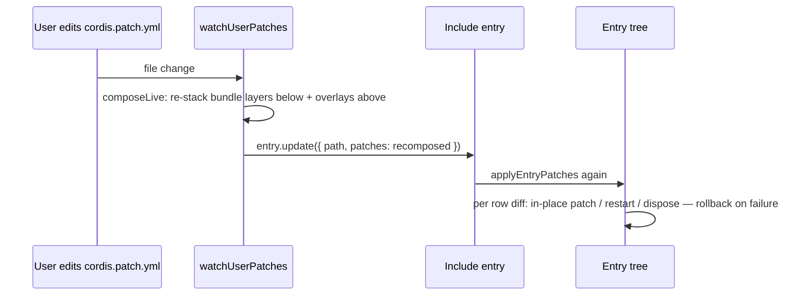
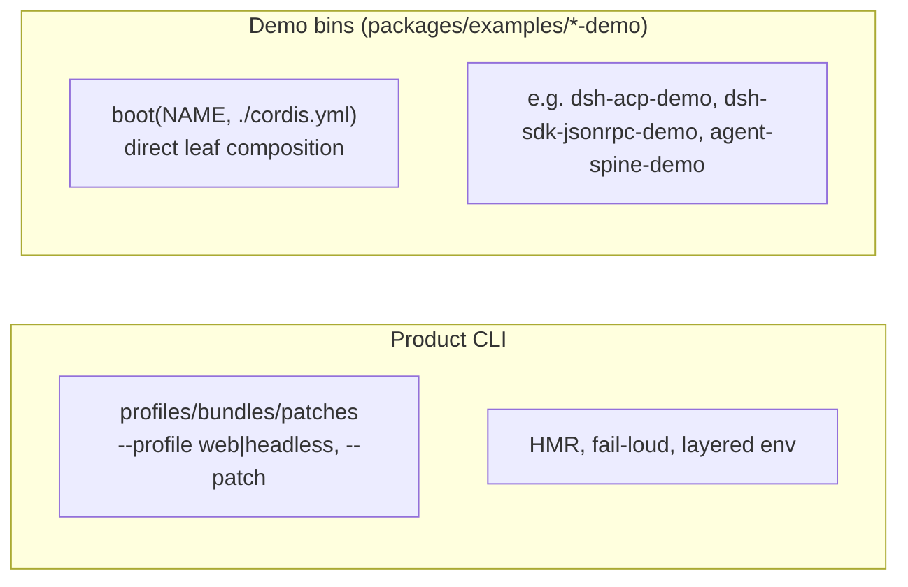

# 03 — Composition and Boot: Profiles, Bundles, Patches

A running `dsh` is a **plugin tree composed at boot from ordered layers**. No code writes the tree; YAML does.

## Profiles and bundles



A **bundle** is a distribution format for Cordis config rows plus the code they mount. Whatever a bundle inserts stays **patchable** by the layers above it.

Two shipped templates exist (`apps/cli/src/profile-boot.ts`, `packages/boot/app-boot/src/profile.ts:114`):

| Template | Bundle stack | Result |
|---|---|---|
| `web` | `[dsh-base, dsh-web-app]` | Full browser app over HTTP/WebSocket |
| `headless` | `[dsh-base, dsh-headless]` | One-shot task runner, no server |

## Patch layering order

Layers apply to the empty entry list, lowest first (`apps/cli/src/profile-boot.ts:122-171`):



Semantics of `applyEntryPatches` (`vendor/include/src/index.ts:58-128`):



This is why `dsh-web-app` "disables" base tool rows (`disabled: true`) instead of deleting them — the base layer keeps them patchable, and per-session **agent presets** take over that role.

## The boot sequence

Product CLI path — `apps/cli/src/bin.ts` → `apps/cli/src/profile-boot.ts` → `packages/boot/app-boot/src/index.ts`:

```mermaid
sequenceDiagram
    participant U as User
    participant CLI as apps/cli (parseDshArgs)
    participant PB as profile-boot (runProfile)
    participant BOOT as app-boot (boot)
    participant LOADER as vendored Loader
    participant INCL as cordis:include
    participant PLUG as Plugins
    U->>CLI: dsh --profile web "task"
    CLI->>PB: loadLayeredEnv → process.env snapshot (rejects bootstrap-only names)
    PB->>PB: composeProfile(name, patchFiles):<br/>flatten all 5 layers into one patch list
    PB->>BOOT: boot(NAME, configPath, patches, prepare)
    BOOT->>BOOT: ctx = new Context(); ctx.baseUrl = dir of cordis.yml
    BOOT->>BOOT: ctx.provide('dshHomePath', ...); await ctx.plugin(Loader)
    BOOT->>PB: prepare(ctx) — launch env + cmdline args
    BOOT->>LOADER: mountRootInclude: register cordis:include + cordis:group builtins
    LOADER->>INCL: create pinned entry { id: 'include', config: { path, patches } }
    INCL->>INCL: read YAML → applyEntryPatches(rows, patches) → root.update(rows)
    LOADER->>PLUG: per row: import module, interpolate !!js, start fiber
    Note over LOADER,PLUG: activation is inject-driven, not row-order-driven
    BOOT->>BOOT: await ctx.get('loader').await() — settle whole tree
    BOOT->>BOOT: assertEntriesActivated — fail loud with per-row reasons
    BOOT-->>PB: running context
    PB->>PB: watchUserPatches — HMR on profile/home patch files
    PB->>PLUG: mount cordis-plugin-timer + hmr when no hmr row exists
```

Failure anywhere disposes the partial tree (`ctx.fiber.dispose()`), and `installFailLoud` turns a late unhandled rejection into one labelled stderr line + exit 1, restoring the terminal first (`packages/boot/app-boot/src/index.ts:609`).

## Live user edits: HMR



## Inspect what your machine boots

```sh
dsh --profile web --dump-config
```

`renderConfigDump` (`packages/boot/app-boot/src/index.ts:379`) runs the **same** `applyEntryPatches` call the boot uses, with per-layer provenance comments — so dumps, flags, and boots cannot drift. Any printed row can be replaced by a patch of your own.

## Two boot shapes



Both call the same `boot()`. The demos skip profile machinery entirely.

Next: [04-agent-loop.md](04-agent-loop.md) — what the composed tree actually *does*.
