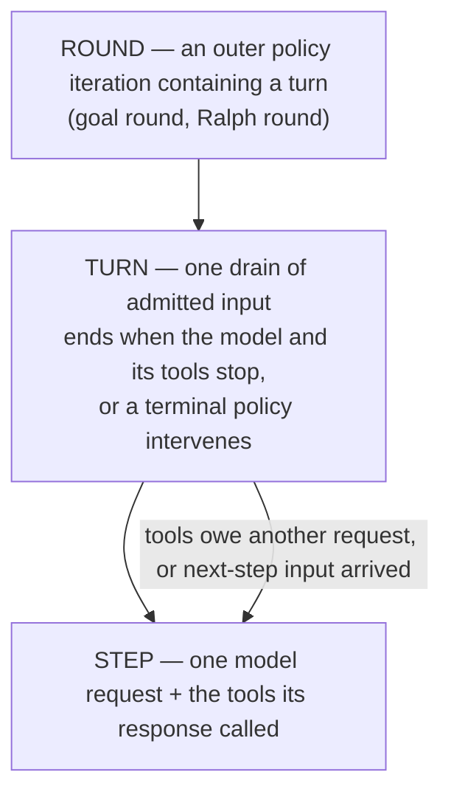
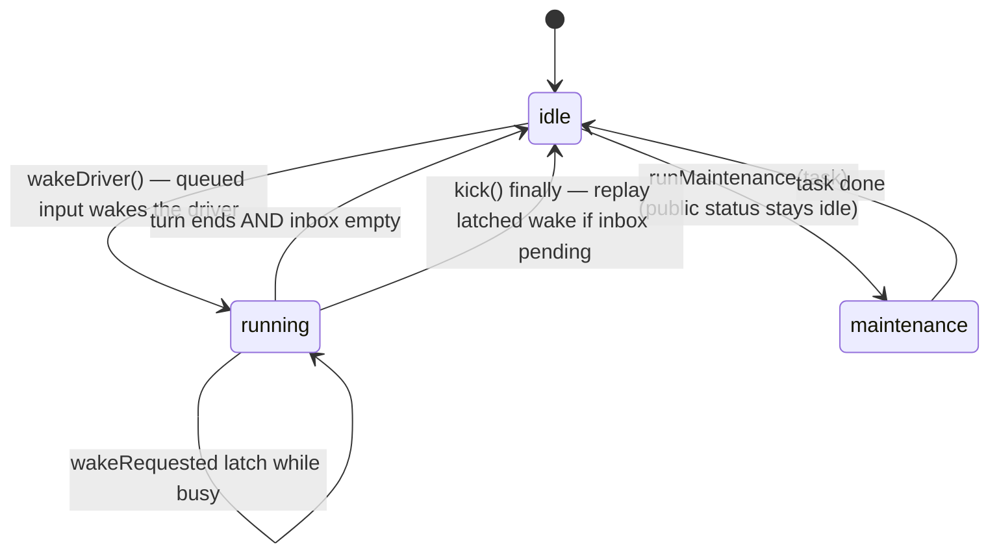
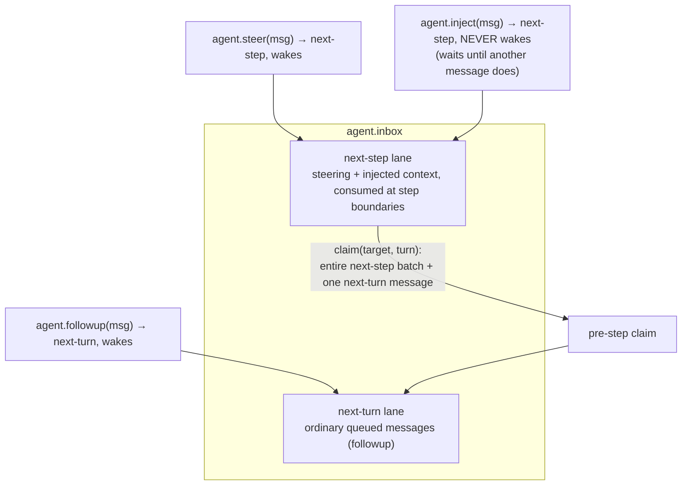
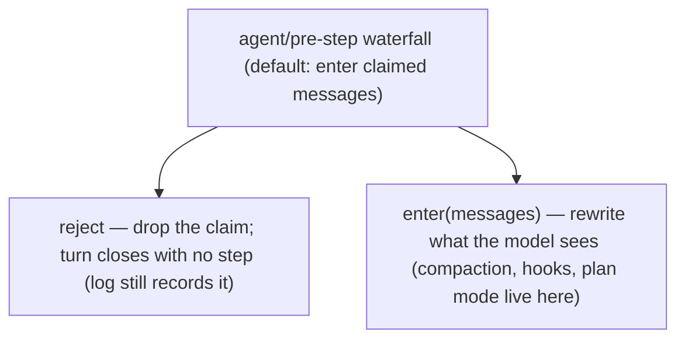
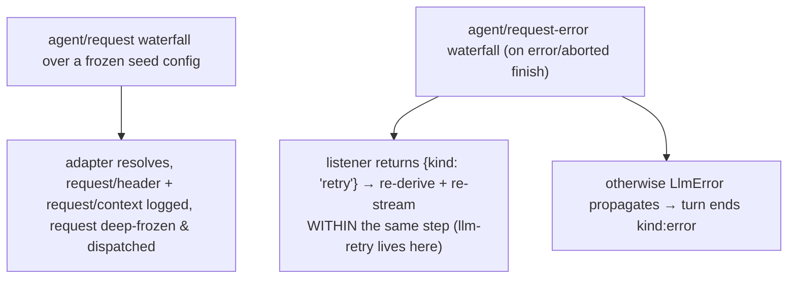
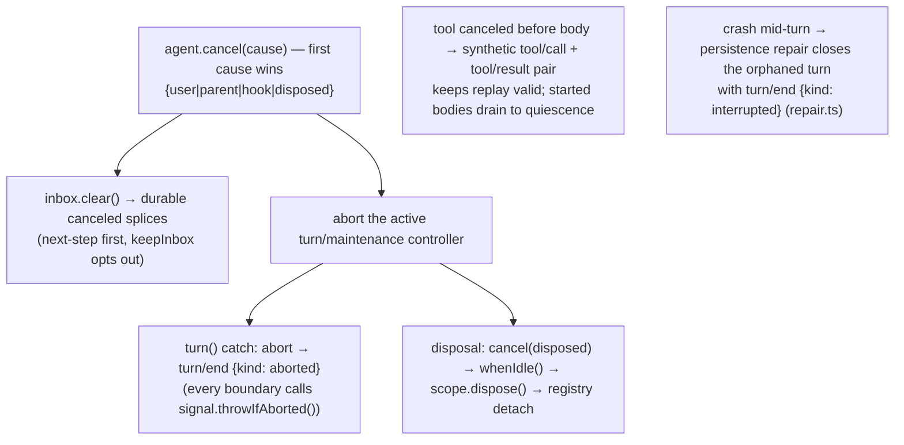

# 04 — The Agent Loop: Turns, Steps, and the Inbox

The default driver is `ReactLoopAgent` (`packages/core/agent-loop/src/agent.ts`). It turns admitted input into model requests, tool executions, and a durable transcript.

## The unit hierarchy



## The phase machine



## The inbox: two lanes, three intents

`Inbox` (`packages/core/agent/src/inbox.ts`) is a **durable projection** — every mutation appends an `agent/inbox/spliced` session event before mutating, so queue state replays from the log.



## The turn, as a sequence

Durable events are `turn/*`, `step/*`, `user/message`, `assistant/*`, `tool/*`; everything else is live coordination. (Condensed from `docs/agent-lifecycle.md`; the driver source is `packages/core/agent-loop/src/agent.ts:246-401`.)

```mermaid
sequenceDiagram
    participant IN as Inbox
    participant DR as Driver (ReactLoopAgent)
    participant PS as agent/pre-step waterfall
    participant REQ as agent/request waterfall
    participant LLM as ctx.llm (llm/stream waterfall)
    participant TL as ctx.tools
    participant LOG as Session log

    DR->>LOG: turn/start {turn}
    DR->>IN: claim(next-turn): one message + whole next-step batch
    DR->>PS: agent/pre-step {messages, turn, step} — authoritative decision
    alt reject / empty first claim
        DR->>LOG: turn/end {kind: blocked|completed} — no step spent
    else enter
        DR->>LOG: step/start {turn, step}
        DR->>LOG: user/message per entered message (surfaceOp: append)
        DR->>REQ: agent/request → config proposal (provider/model/tools)
        DR->>LLM: llm/stream(request)
        LLM-->>DR: StreamChunk*
        DR->>LOG: assistant/chunk {turn, step, chunk} — per chunk
        DR->>LOG: assistant/message {message, usage, sourceEventSeqs}
        alt response has tool calls
            loop classify by executionMode; barriers + rolling pool
                DR->>LOG: tool/call
                DR->>TL: pre-execute → execute → post-execute
                DR->>LOG: tool/result (cites its tool/call seq)
            end
            DR->>LOG: step/end
            Note over DR: tools owe another request → claim next-step → next step
        else no tool calls / max-tokens
            DR->>LOG: step/end
        end
        opt natural stop and inbox empty
            DR->>PS: agent/turn-stopping (serial, no next()) — terminal checkpoint
        end
    end
    DR->>LOG: turn/end {reason}
```

### What `agent/pre-step` can do

Listeners wrap `next()`; the returned decision is **authoritative**:



### What `agent/request` and `agent/request-error` can do



## The model-history invariant

Each step calls `session.deriveMessages()` — a pure projection of the log (see [05-session-log.md](05-session-log.md)) — and an invariant companion (`packages/core/agent-loop/src/invariant.ts:39`) asserts the dispatched request **byte-equals** the projection. The model can never see anything the log cannot reconstruct.

## Cancellation and error recovery



## Agent lifecycle and goals

- The `Agent` interface (`packages/core/agent/src/runtime-types.ts:64`) exposes `session`, `inbox`, `status`, `ctx` (the agent's scoped context), `cancel`, `whenIdle`, `runMaintenance`, `send/followup/steer/inject`.
- `AgentHandle.dispose()` is a capability: only the holder can tear the agent down (`packages/core/agent/src/index.ts:172`).
- **Goal rounds**: `dsh-goal` keeps a durable objective on the session; `goal-round-driver` materializes each goal round as one goal-sourced turn. Activation must be re-armed by a human mutation after resume/fork (`docs/glossary.md` goal section).

Next: [05-session-log.md](05-session-log.md) — the durable source of truth everything derives from.
