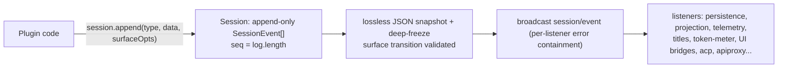
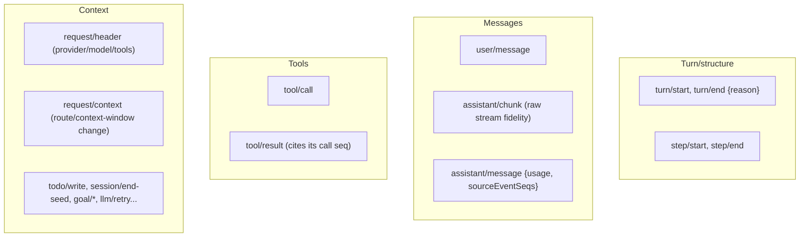
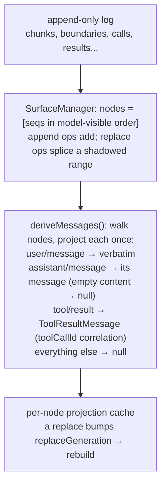
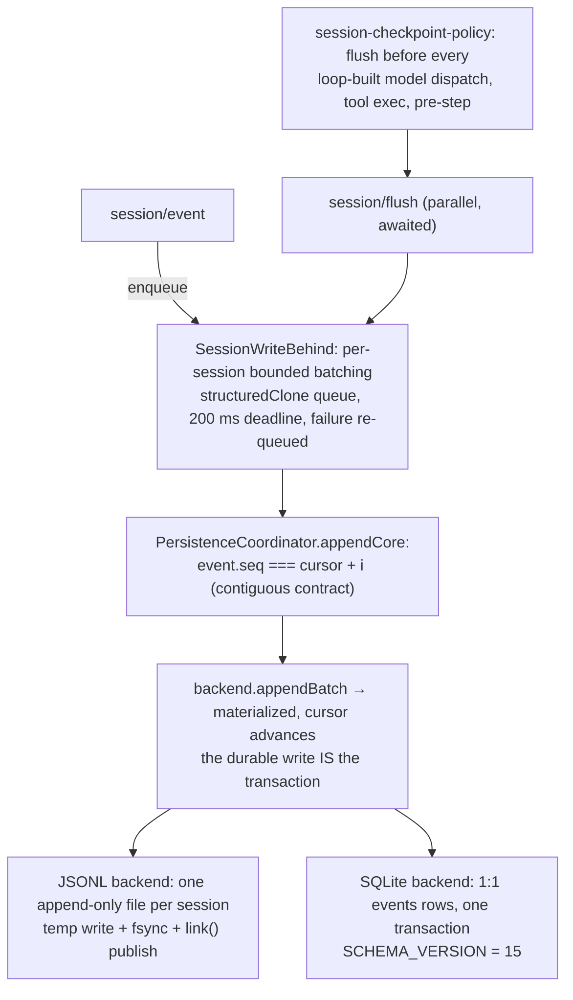
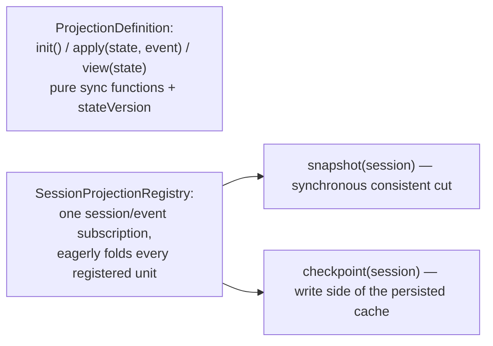
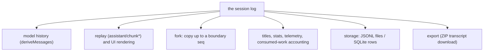

# 05 — The Session Log: Event Sourcing and the Surface

`dsh-session` (`packages/core/session`) owns an **append-only event log** per session. Everything the model sees, everything the UI renders, and everything persisted derives from this stream. `ctx.sessions` is the store.

## Event sourcing

## Durable events (SessionEventMap)

- `SESSION_FORMAT_VERSION = 0` (`packages/core/session/src/types.ts:56`) — no compatibility promise pre-release; structural changes bump it.
- New event types ride the per-event `ignorable` envelope: builds that don't know a type refuse the log unless the event is marked `ignorable: true`.

## The surface: which events become model-visible messages

Only three event types produce messages: `user/message`, `assistant/message`, `tool/result` (`packages/core/session/src/surface.ts:15`). `SurfaceManager` folds the log into an ordered node list, so history is a **pure projection**:

A `tool/result` **must** cite its `tool/call` via `sourceEventSeqs: [callSeq]` and the result block's `toolCallId` must equal the call id — validated at append/load (`packages/core/session/src/index.ts:301`). Compaction shrinks history by appending a `replace` surface op that shadows deleted nodes, keeping replay honest.

## Persistence write path

Crash recovery (`packages/session/session-persistence/src/coordinator.ts:892`): on load, a torn tail is repaired and any orphaned open turn gets a synthetic `turn/end {kind: 'interrupted'}`.

## Projection: derived state over the same stream

Consumers: `token-meter` (usage/context-pressure), `session-stats` (whole-log stats). The projection cache (`dsh-session-projection-cache`) is a fold shortcut, never an authority — stale is allowed, wrong is not.

## What derives from the log

Next: [06-scope-and-tools.md](06-scope-and-tools.md) — how tools register, scope, and execute.
