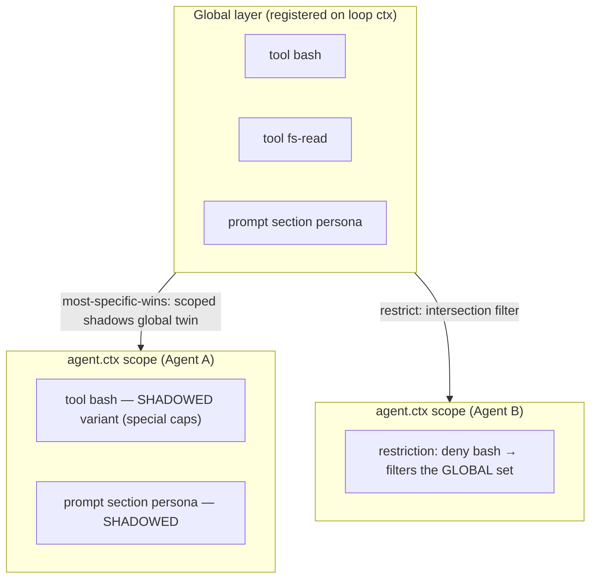
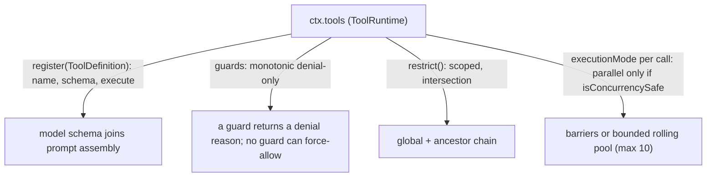
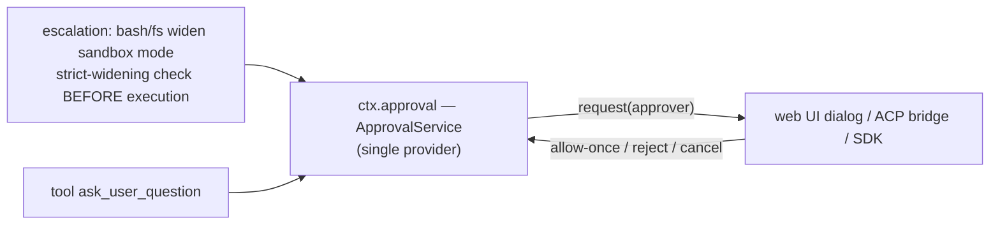

# 06 — Scope and the Tool Pipeline

Tools are the primary model-facing capability. Two mechanisms shape them per agent: **scope** (whose tools exist) and the **execution pipeline** (how a call becomes a result).

## Scope: global vs per-agent registrations

`packages/core/scope` provides the primitive; a live **Agent is the key of its own scope** (`agent.ctx`). Registrations through `agent.ctx` are scope-visible AND scope-lifetime; global registrations are visible to every agent.



- **Shadowing**: a scoped tool/section/variable replaces its same-named global twin for that scope alone (`packages/core/scope/src/store.ts:159`).
- **Restrictions** (`tools.restrict`): filter only what the scope *inherits*; the scope's **own** registrations are exempt. A filtered-away tool is absent from the prompt AND refuses execution — indistinguishable from nonexistent.
- **Setup window**: `CreateAgentOptions.setup` runs after scope+agent exist, before publication — creators register there, never drive the agent.
- **Lineage** (parent/child facts) is data, never scope structure; subagents don't inherit scoped registrations.

## The tool registry



## The execution pipeline

Every call goes through `tools/pre-execute → guard → tools/execute → tools/post-execute` (`packages/core/tools/src/index.ts:1342-1676`):

```mermaid
sequenceDiagram
    participant L as Agent loop
    participant T as ToolRuntime
    participant PRE as tools/pre-execute waterfall
    participant G as guards
    participant EX as tools/execute waterfall
    participant BODY as tool body
    participant POST as tools/post-execute waterfall
    participant LOG as Session log

    L->>LOG: tool/call (model-order commit)
    L->>T: execute(toolCall)
    T->>T: createExecution: token minted, args lossless-snapshot + deep-frozen
    T->>PRE: pre-execute (default allow)
    alt ask
        PRE->>T: approval seam: ask user → allow/deny (degrade to deny without approval service)
    else deny
        PRE-->>L: denied result
    else allow
        T->>G: guard chain: global guards first, farthest ancestor first
        alt guard denies
            G-->>L: denial result
        else pass
            T->>T: cancellation re-check (ABORTED_BEFORE_DISPATCH)
            T->>EX: execute (default: dispatch tool body; wrappers may only replace exec.signal)
            EX->>BODY: run(args, exec)
            BODY-->>EX: value/content
            T->>POST: post-execute (accept | block{feedback} | rewrite content)
            alt block
                POST-->>L: error result with corrective feedback
            else accept
                T->>T: finalizeContent (tool-owned) → tools/result emit (frozen exec)
                L->>LOG: tool/result (cites tool/call seq)
            end
        end
    end
```

Failure vocabulary: `TOOL_ABORTED` (canceled mid-body), `TOOL_ABORTED_BEFORE_DISPATCH`, `ToolNotFoundError`, `ToolOutputError` — plus tool-specific codes like `SANDBOX_UNAVAILABLE`, `FS_STALE_VERSION`.

## Approval and interaction



## Tool execution modes and presentation

- **executionMode**: `parallel` (only exact-`true` `isConcurrencySafe`, fail-closed) or sequential; parallel calls run in exclusive barriers or a bounded rolling pool (`packages/core/agent-loop/src/tool-calls.ts:59`); results commit in **model order**.
- **Presentation** (`dsh-agent-tool-presentation`): `generic`/`terminal`/`diff`, with `locations`; render methods are pure functions of `args`.
- **Code mode**: the reserved `run_code` transport runs code in `dsh-code-runtime` (worker thread); collapsed calls terminate before the policy pipeline.

Next: [07-capability-seams.md](07-capability-seams.md) — the pattern that makes bash, fs, web, LSP, and subagents swappable.
