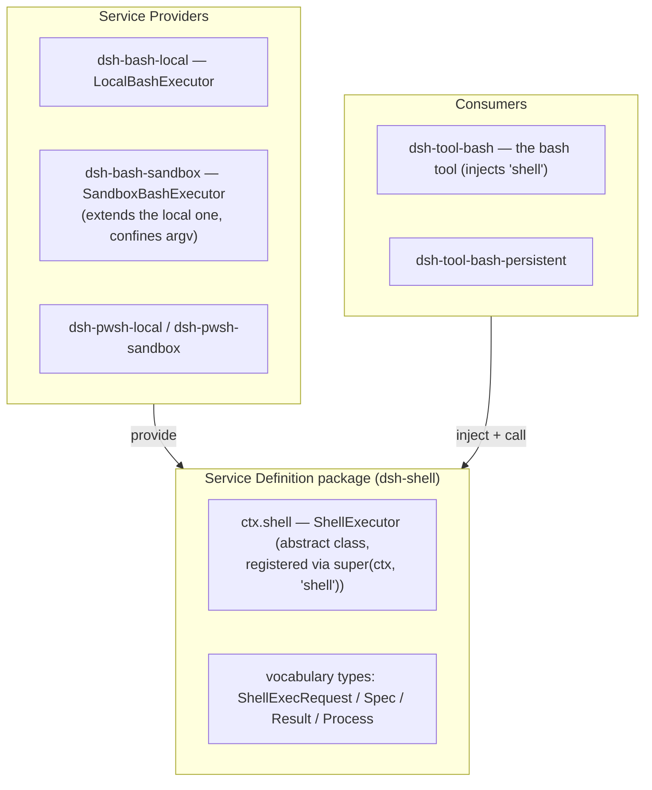
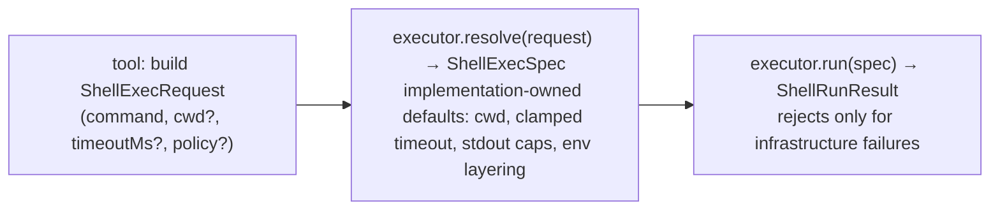
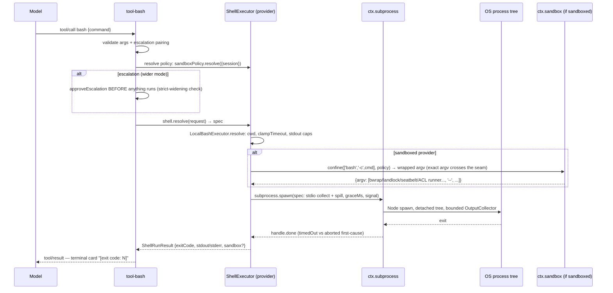
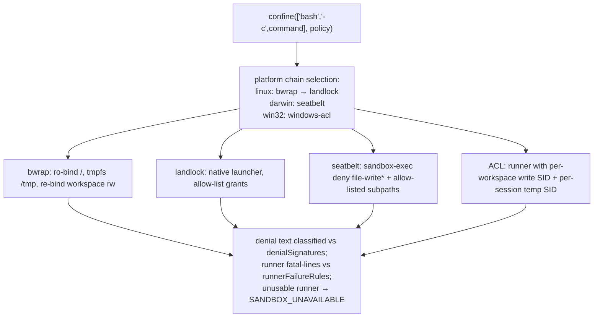
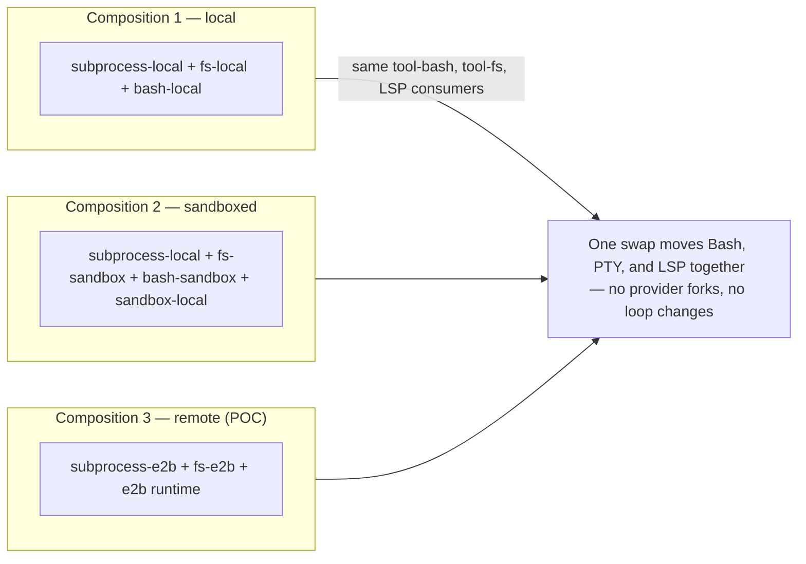
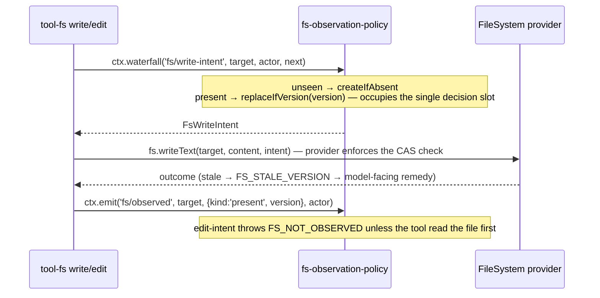
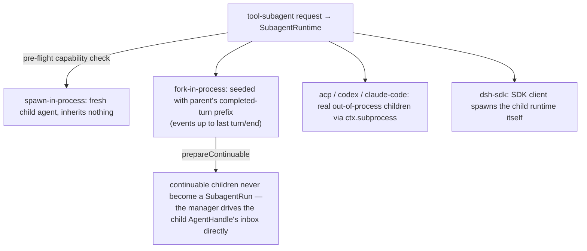

# 07 — Capability Seams: the Three-Role Pattern

A **seam** is a swappable capability with three roles. One role alone is not a seam; adding a capability means designing all three. `packages/shell` is the canonical example.

## The pattern

Roles normally occupy separate packages when they evolve independently, but a package may own several roles when they are one concern (`dsh-llm` owns its Service Definition and Consumer).

## The resolve/spec split: explicit defaults at package boundaries

Defaults are an explicit `resolve(request): Spec` step in the owning implementation — never a hidden `?? default` inside `run()`:

## The shell seam, end-to-end (foreground bash)

### The sandbox seam

`SandboxProvider.confine(argv, policy)` takes the **exact argv about to be spawned** and returns `{argv, enforcement, denialSignatures, runnerFailureRules}` — fail-closed, never a silent unconfined pass (`packages/sandbox/sandbox/src/index.ts:175`):

`dsh-bash-sandbox` stays mechanically identical to the local executor — the only additions are policy resolution, denial classification, and `result.sandbox` stamping. The tool advertises `sandbox_permissions`/`justification` args only when `ctx.shell.sandboxMode` is defined.

## The seam inventory

| Seam | Service Definition (ctx key) | Providers | Consumers |
|---|---|---|---|
| Bash/PowerShell | `ctx.shell` — ShellExecutor | bash-local, bash-sandbox, pwsh-* | tool-bash, tool-pwsh |
| Subprocess | `ctx.subprocess` — SubprocessRuntime | local, e2b | bash executors, terminal, LSP, subagents |
| Filesystem | `ctx.fs` — FileSystem | local, sandbox, e2b | tool-fs, str-replace-editor, LSP, skills |
| Sandbox | `ctx.sandbox` — SandboxProvider | local (bwrap/landlock/seatbelt/ACL) | bash-sandbox |
| Sandbox policy | `ctx.sandboxPolicy` | single impl | bash-sandbox, fs-sandbox, terminal, tools |
| LSP | `ctx.lsp` — Lsp registry | stdio (multi-server over fs+subprocess) | tool-lsp |
| Web | `ctx.web` — WebRuntime registry | search-exa/perplexity/deepseek, fetch-http | tool-web |
| Skill | `ctx.skills` — SkillRegistry | filesystem, badge | tool-skill |
| Subagent | `ctx.subagents` — SubagentRuntime (named-provider registry) | spawn/fork in-process, acp, codex, claude-code, dsh-sdk | tool-subagent(-control/-report), workflow |
| Workflow | `ctx.workflowEngine` | worker-thread | tool-workflow, tool-ralph |
| Terminal | `ctx.terminals` — TerminalSessionService | terminal-bash (over subprocess) | tool-terminal |
| Jobs | `ctx.jobs` — JobRegistry | jobs-local | tool-jobs, bash background |
| Compaction | `ctx.compaction` | compaction-basic | /compact command |
| Approval | `ctx.approval` | single impl | tool-bash/fs escalation, ask-user |
| Goal | `ctx.goals` | single impl | tool-goal, command-goal, goal-round-driver |
| E2B (POC) | `ctx.e2b` | single impl | fs-e2b, subprocess-e2b |
| LLM | `ctx.llm` — LlmRuntime | deepseek, pi-ai | agent-loop |

## The point of seams: provider swaps

### FS policy events (no service, event-only policy)

Dropping the policy plugin degrades gracefully: the tools' default `() => undefined` yields the bare provider's unconditional atomic write.

### Subagent providers: a named-provider registry

Unlike `ctx.shell` (second load throws), `ctx.subagents` keeps **multiple providers coexisting**; callers pick by name (`packages/subagent/subagent/src/index.ts:171`). Providers advertise capabilities (`outputSchema`, `depthLimit`, `toolFilter`, `persona`); the runtime rejects a request needing a capability the provider lacks **before** the provider starts.

Next: [08-event-system.md](08-event-system.md) — the full event taxonomy.
