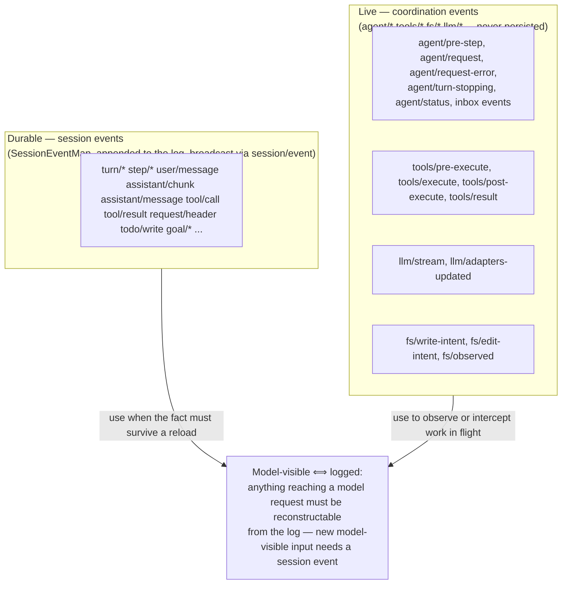
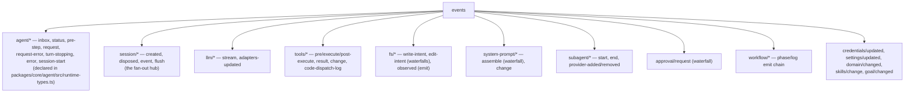
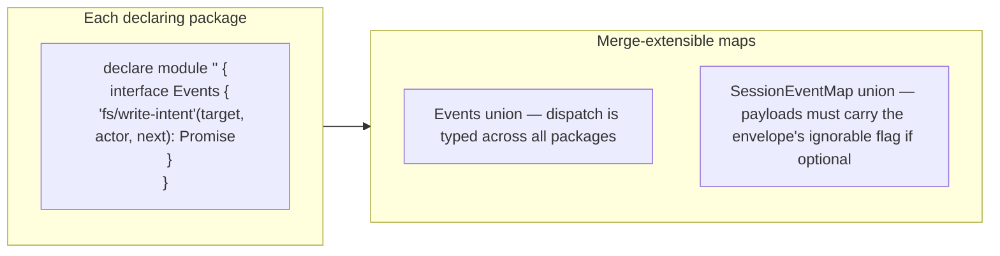
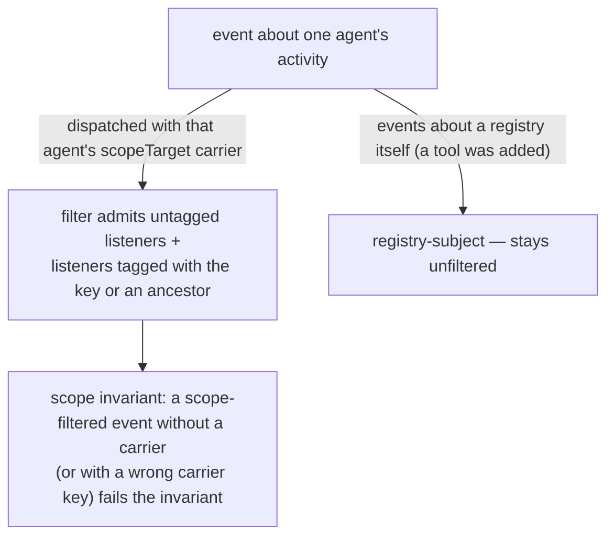
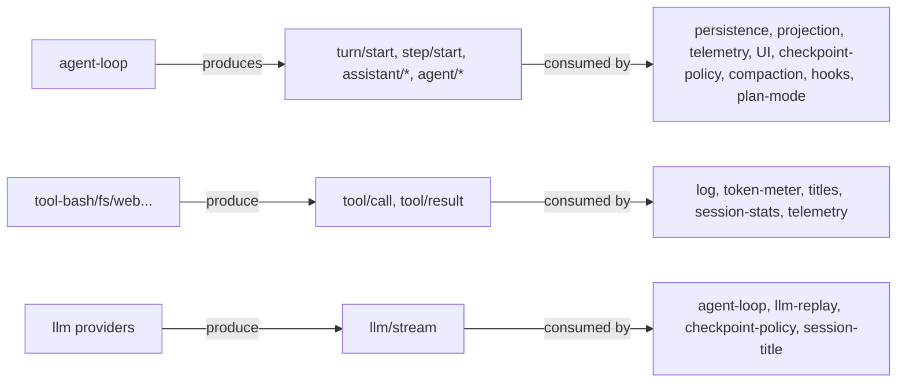

# 08 — The Event System: Domains and Dispatch

Events are the extension points. Picking the right domain is the first decision in most changes. (The authoritative matrix is the generated [event map](../docs/event-producer-consumer.md).)

## Two planes: durable vs live

## Dispatch-mode vocabulary

| Mode | Behavior | dsh examples |
|---|---|---|
| `emit` | sync fire-and-forget | `session/event`, `agent/status`, `tools/result`, `fs/observed` |
| `parallel` | await all listeners | `session/flush` |
| `serial` | in order, can bail | `agent/turn-stopping` |
| `bail` | sync until truthy | (registry checks) |
| `waterfall` | listeners wrap `next()`; not calling it short-circuits | `agent/pre-step`, `agent/request`, `agent/request-error`, `llm/stream`, `tools/*-execute`, `fs/*-intent`, `system-prompt/assemble`, `approval/request` |

**Waterfall semantics are the critical rule:** a listener must call `next()` to delegate; returning without it owns the decision. `agent/pre-step` decides what the model sees; `fs/write-intent` decides the freshness policy; `agent/request-error` decides retry.

## Domain taxonomy

## Typed events via declaration merging

Session events additionally require JSDoc `@mode` + payload `@param`s; scoped keys absent from payloads need `@dshScopeScan unsupported`. `SessionEventMap` members are required-on-read by default.

## Scoped dispatch

## Producer → consumer highlights

Next: [09-llm-layer.md](09-llm-layer.md) — the model adapter seam.
