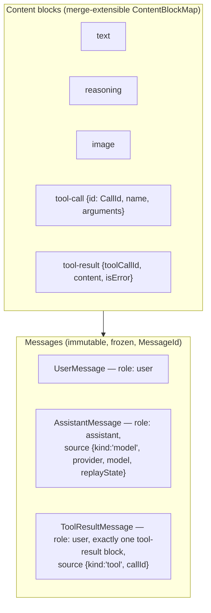
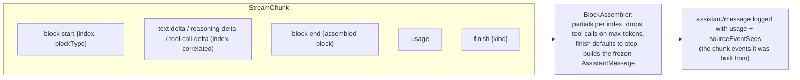

# 09 — The LLM Layer

`dsh-llm` (`packages/llm/llm`) owns the message vocabulary and the adapter seam. Providers (`dsh-llm-deepseek`, `dsh-llm-pi-ai`) register adapters; the agent loop consumes `ctx.llm`.

## Message vocabulary



One immutable `Message` representation is shared by delivery, durable history, and model requests.

## The adapter seam: `LlmRuntime` (ctx.llm)

```mermaid
sequenceDiagram
    participant PROV as Provider plugin (llm-deepseek)
    participant RT as LlmRuntime
    participant LOOP as agent-loop
    participant AD as DeepSeekAdapter
    participant API as DeepSeek API

    PROV->>RT: registerAdapter(['deepseek-official'], adapter)<br/>all-or-nothing; duplicate route → DUPLICATE_ADAPTER
    Note over RT: registration is a ctx.effect:<br/>unload removes routes, emits llm/adapters-updated
    LOOP->>RT: prepareCall(config) → PreparedLlmCall<br/>(config + adapter + retry policy captured in one frozen one-shot — HMR-safe)
    LOOP->>RT: stream(request)
    RT->>RT: ctx.waterfall('llm/stream', options, () => adapterStream(...))
    Note over RT: listeners wrap the chain (llm-replay, telemetry,<br/>checkpoint-policy); short-circuit = don't call next()
    RT->>AD: adapter.stream(request)
    AD->>API: SSE request
    API-->>AD: deltas → translated to chunks
    AD-->>RT: StreamChunk* → finish
    RT-->>LOOP: assembled stream
```

## The chunk protocol and BlockAssembler

Adapters translate provider-specific SSE deltas into one canonical `StreamChunk` protocol (`packages/llm/llm/src/types.ts:291`), and one canonical assembler turns chunks into a message:



`FinishReasonMap`: `stop | tool-calls | max-tokens | aborted | error` (last two carry an `LlmFailure`). Adapter failures are converted to a terminal `finish` chunk; consumer/middleware failures stay thrown (`packages/llm/llm/src/index.ts:843-939`).

## Retry lives on the loop's request-error event, not the stream

```mermaid
sequenceDiagram
    participant LOOP as agent-loop step()
    participant ERR as agent/request-error waterfall
    participant RET as dsh-llm-retry
    participant LOG as Session log

    LOOP->>LOOP: llm.stream → finish {kind: error|aborted}
    LOOP->>ERR: dispatch request-error
    ERR->>RET: listener
    RET->>RET: recover(): scan log for prior llm/retry (policyKey/turn/step/provider)<br/>→ resume counts across replays; honor providerRetryAfterMs ≤ maxDelayMs
    RET->>LOG: llm/retry event BEFORE the wait (durable), then llm/retry-started
    RET->>LOOP: {kind: 'retry'}
    LOOP->>LOOP: re-derive + re-stream within the SAME step (no new step/start)
```

Defaults (`packages/llm/llm/src/retry-policy.ts:14`): maxRetries 2, 500 ms initial, 10 s max, 0.1 jitter, retryable codes `EMPTY_RESPONSE | RATE_LIMIT | SERVER | TIMEOUT | TRANSPORT`. Policies are captured per route at registration; the deepseek plugin re-registers in place when the policy changes (`packages/llm/llm-deepseek/src/index.ts:258`).

## Provider notes

- **llm-deepseek**: one `DeepSeekAdapter` on route `deepseek-official`; baseURL/key/userId resolve per request (no re-registration needed); SSE translation in `packages/llm/llm-deepseek/src/translate.ts:86`.
- **llm-pi-ai**: one adapter instance owns many provider routes; immutable per-config-generation model snapshot so a config change can never swap providers mid-request.
- **token-meter**: registers usage/context-pressure projections over the session log.

Next: [10-web-api-and-rpc.md](10-web-api-and-rpc.md) — how the browser and external clients reach the harness.
