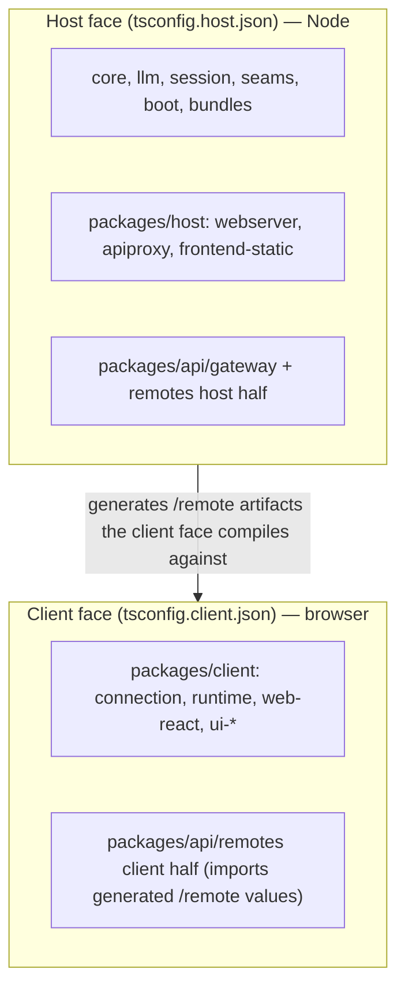
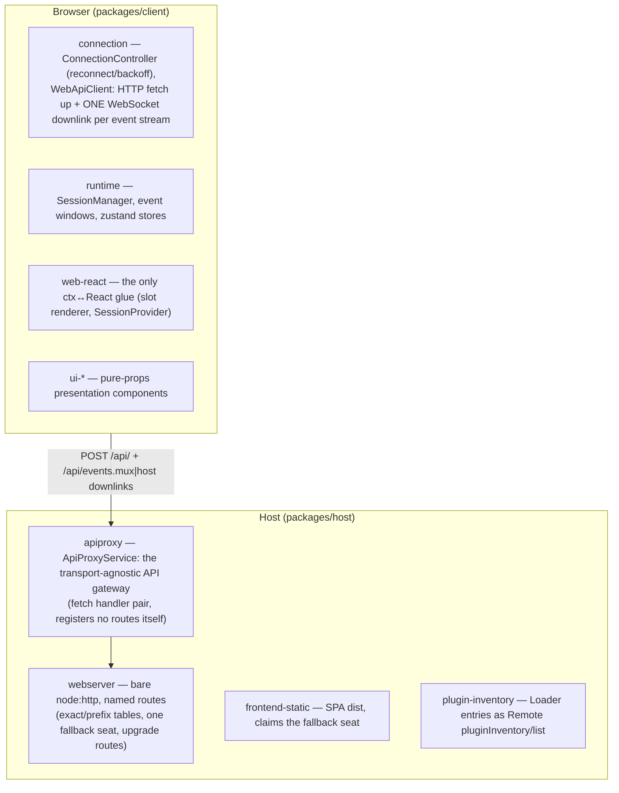
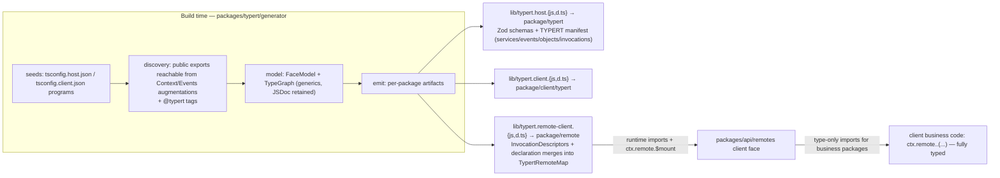
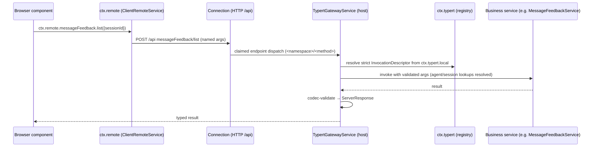
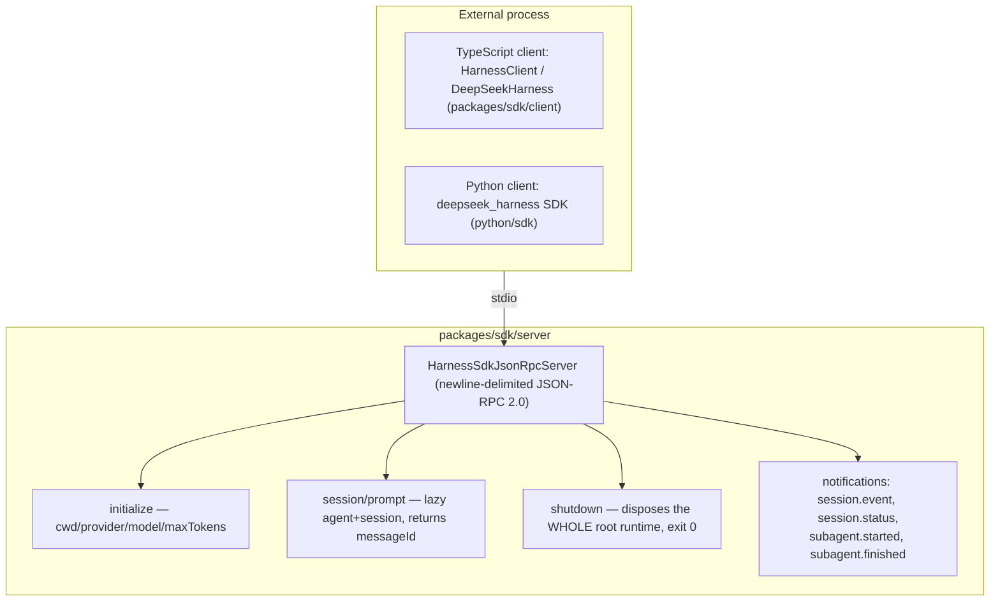

# 10 — Web, API, and RPC: The Client/Server Split

There are **three** client/server surfaces, all on the same plugin spine:

1. **Web GUI** — browser ↔ Node host over HTTP + WebSocket (`packages/host/` + `packages/client/`).
2. **Typert Remotes** — a generated, typed RPC seam carried inside the web split's transport (`packages/typert/` + `packages/api/`).
3. **SDK / ACP** — JSON-RPC over stdio for external automation (`packages/sdk/`, `packages/acp/`, `python/`).

## The two compiler faces



Each package is registered in exactly one face; packages with browser halves expose a `/client` subpath. `packages/api/remotes` is the documented exception, splitting its own project into two faces.

## The web GUI split



The connection protocol is a four-quadrant envelope (`packages/host/apiproxy/src/api/rpc.ts`): `ClientRequest | ServerResponse | ServerRequest | ClientResponse` with branded `RpcId`s. HTTP status expresses only carrier failures; business errors ride as 200 + `result.ok:false`. A trust fence (`api-request-trust.ts`) rejects DNS-rebinding/cross-site requests; privileged methods pin to loopback. Server→browser pushes use `/api/events.mux` + `/api/events.host` WebSocket downlinks; `/api/respond` carries client responses to `ServerRequest`s (approvals, questions).

The legacy BFF exposes ~57 zod-validated methods (`packages/host/apiproxy/src/api/rpc-map.ts:24`): `session.*`, `subagent.*`, `host.*`, `workspace.*`, `skill.list`, `agentPreset.*`, `goal.*`, `settings.*`, `credentials.*`, `llm.*`.

## Typert: generated typed RPC



The host tsdown phase runs the generator with `tsconfig.host.json` as the only seed and produces both the host reflection and the remote-client projection; the client tsdown never runs Typert.

### A Remote call, end-to-end



Event fan-out in reverse: the host forwards allowlisted events (`API_REMOTE_FORWARDED_EVENTS`) as `host/remote-event` frames on the host WebSocket; the client runtime hands them to `ctx.remote.$dispatch`, and subscribers receive them with their owner package's own `Events` signatures.

## SDK JSON-RPC (stdio) — external automation



The high-level client API is `prompt → wait for whole-agent idle → collect events → finalResponse`. The Python SDK starts a matching bundled runtime (`python/sdk-runtime`).

## ACP — automation-only Agent Client Protocol

`packages/acp/acp` speaks the [Agent Client Protocol](https://agentclientprotocol.com) over JSON-RPC stdio (`packages/acp/acp/src/index.ts:105`) — an interoperability transport, not a UI:

```mermaid
sequenceDiagram
    participant C as ACP client (e.g. an IDE)
    participant S as dsh-acp server
    participant A as Agent

    C->>S: initialize → baseline prompts only
    C->>S: session/new → fresh agent (absolute cwd)
    C->>S: session/prompt (text blocks concatenated; one in-flight per session)
    S->>A: prompt; settles at whole-agent idle → end_turn
    A-->>S: committed assistant/message → one agent_message_chunk per text block
    S-->>C: result (stop-reason mapped in codec.ts)
    C->>S: session/request_permission → one-shot allow/reject
    Note over S: teardown: reject new work, settle pending,<br/>drain continuable descendants, dispose in parallel
```

No navigation, replay, modes, elicitation, or tool presentation — `subagent-acp` is the primary in-repo client.

## Adjacent services

- **session-query** (`ctx.sessionQuery`): combined session-history reads, traces, filters, FTS5 full-text search (SQLite provider) + a model-facing tool + ZIP log export.
- **attachment** (`ctx.attachments`): image validate/save/read with limits; local backend.
- **message-feedback**: the canonical `TypertRemoteService` example with `@Remote`-decorated methods.

Next: [11-session-plumbing.md](11-session-plumbing.md) — durability, projection, telemetry, compaction.
