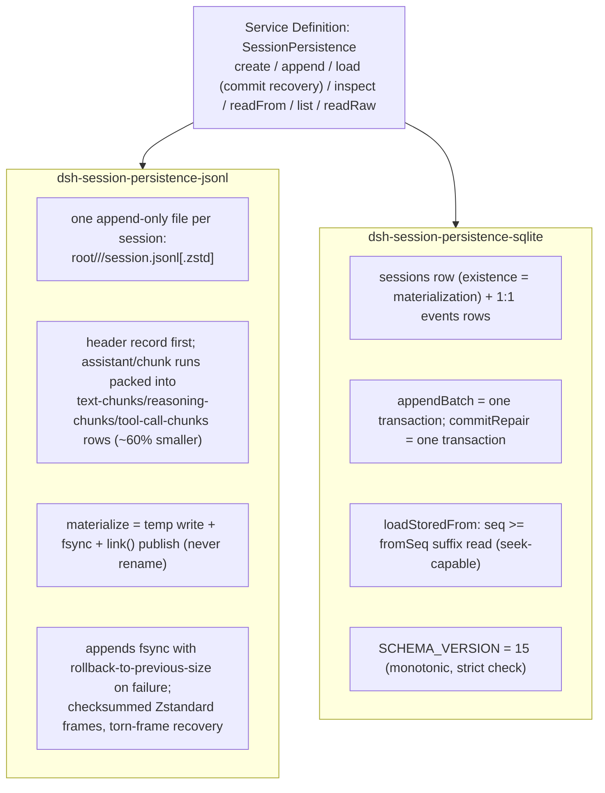
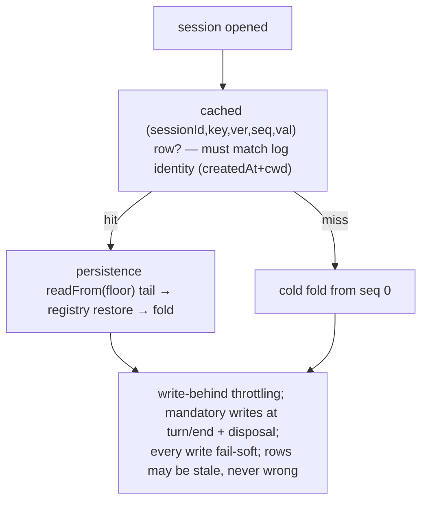
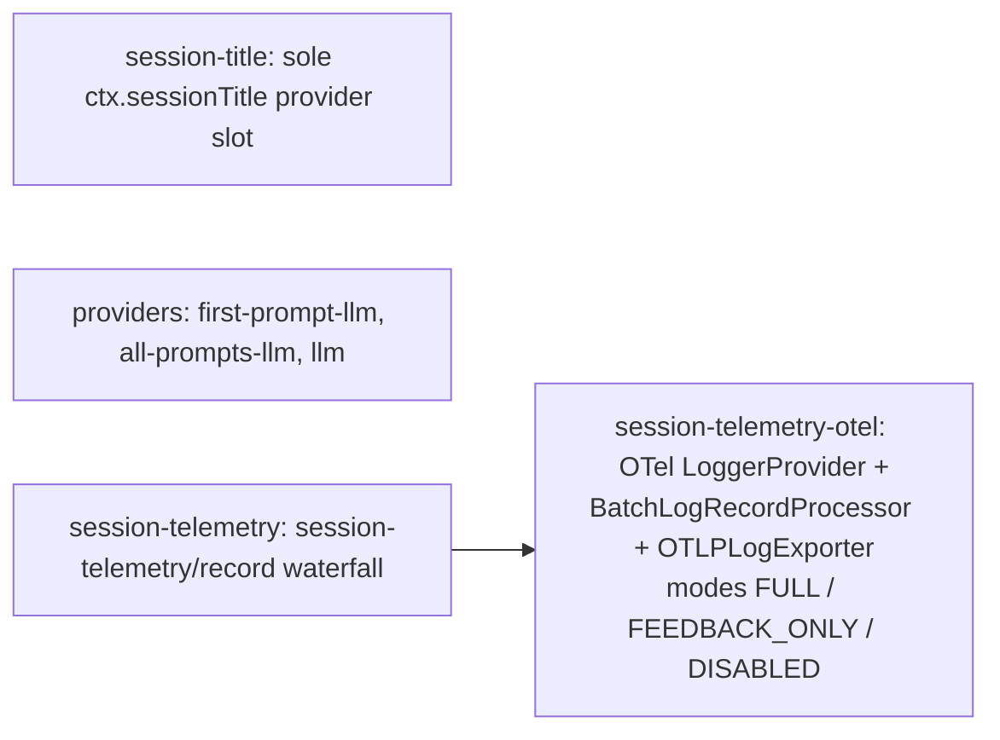
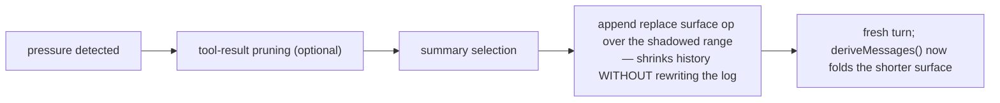
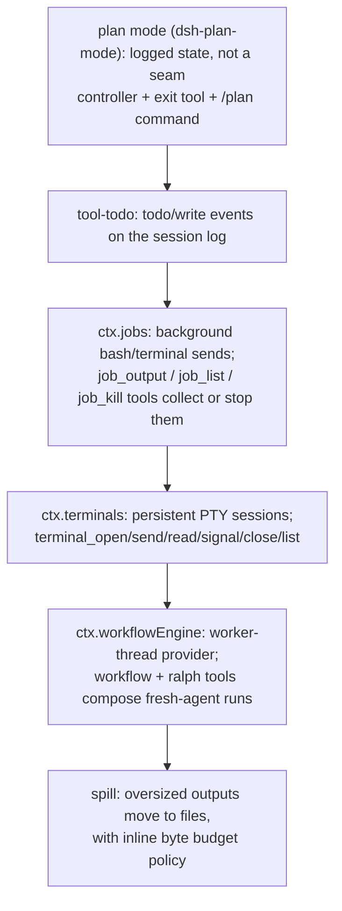

# 11 — Session Plumbing: Persistence, Projection, Telemetry, Compaction

The packages in `packages/session/` (plus `compaction/`, `plan/`, `todo/`) give the log durability and derived value.

## Persistence backends

Both are behind one contract; the coordinator (`packages/session/session-persistence/src/coordinator.ts`) is the single write-path owner: per-session promise chains (writes never interleave), contiguous-seq enforcement, lazy creation, HMR seed-prefix adoption, and torn-tail repair with synthetic `turn/end {kind:'interrupted'}` closers.

## Projection cache: the cold-start ladder

## Titles and telemetry

## Compaction

`dsh-compaction-basic` triggers on `agent/pre-step` (context pressure) and on `agent/request-error` (canonical context overflow), optionally prunes tool results first, then summarizes. Recovery works between the closed failed step and the failed turn close; it opens a fresh retry turn only when pruning or summarization **advances the surface replacement generation** — otherwise the original request error stays authoritative (`docs/agent-lifecycle.md:76`).

## Planning, todos, and background work

Next: [12-monorepo-and-build.md](12-monorepo-and-build.md) — how the many packages compile and get verified.
