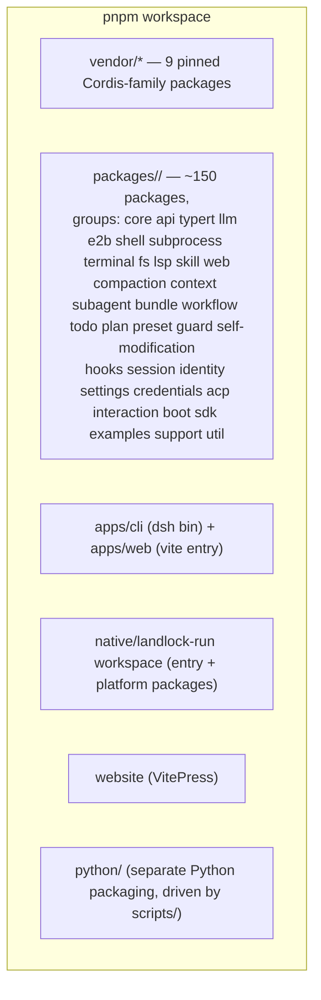
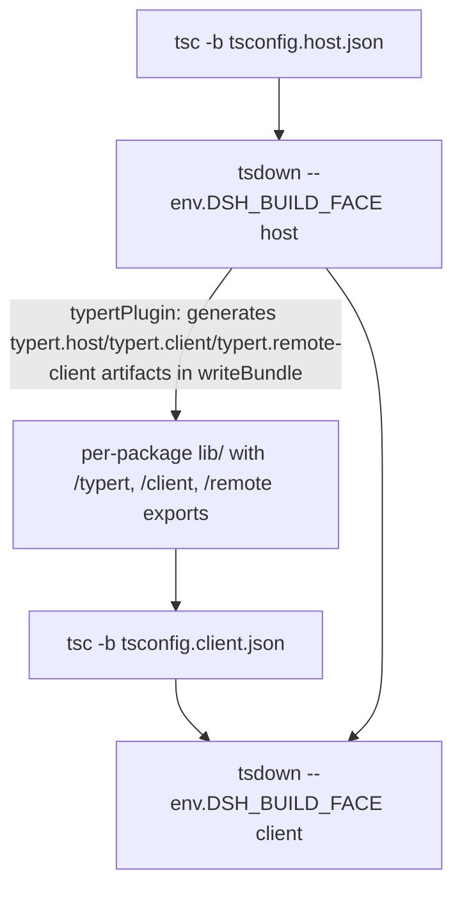
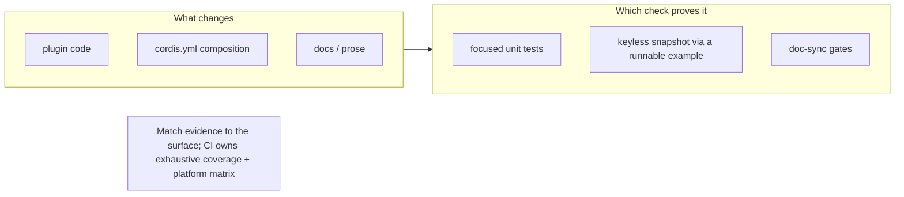
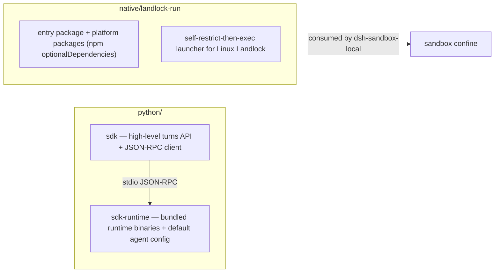

# 12 — Monorepo Layout and the Build Pipeline

## Workspace layout

pnpm workspaces: `vendor/*`, `packages/*/*`, `native/landlock-run` (+ its packages), `apps/*`, `website`. Every npm package is `@deepseek-ai/dsh-<name>`; vendored packages are rescoped and `private: true`; `@deepseek-ai/cordis` is a peerDependency (+ dev) of every harness package.

## ESM and faces

- ESM everywhere (`"type": "module"`); cross-package imports use package names; local relative imports use `.ts`.
- **Source plane vs artifact plane, never mixed**: static gates and tests resolve workspace imports through tsconfig `paths` to `src`; gates consuming built `lib/` declare that dependency.
- Two aggregate programs — `tsconfig.host.json` (Node) and `tsconfig.client.json` (browser) — keep compiler faces explicit; each package uses one aggregate except `api/remotes`.

## Build pipeline

`dsh` source-launch runs through tsx's ESM-only hook (`node --import tsx/esm`), so modules it reaches must stay ESM.

## Verification layers

| Layer | Command | What it proves |
|---|---|---|
| Unit | `pnpm run test` (vitest) | package behavior, focused tests |
| Coverage gate | `pnpm run test:coverage` | per-file 100% on `packages/*/*/src` (the CI gate) |
| Real API | `pnpm run test:e2e` | provider behavior (self-skips without `DEEPSEEK_API_KEY`) |
| Keyless snapshots | `pnpm run test:snapshot` | assembled-app transcripts vs recorded outputs |
| Web | `pnpm run test:web[:perf][:stress]` | built browser app replay |
| Typecheck | `pnpm run typecheck` | both faces compile |
| Lint | `pnpm run lint` | oxlint after contracts build |
| Duplication | `pnpm run duplication` | jscpd clone detection |
| Hygiene | `pnpm run hygiene` | knip + publint + workspace constraints + NodeNext consumer check |
| Docs | `pnpm run doc-sync` | doc budgets, md-links, type-equiv, mermaid, cordis configs... |
| Windows | `pnpm run check:windows-wine` | only when diagnosing a known Windows failure |

`scripts/run-gates.ts` is the gate runner; `check:all` / `check:ci` orchestrate. The repo's own standards live in the root [AGENTS.md](../AGENTS.md) and the skills under `.agents/skills/`.

## The verification philosophy in one picture

## python/ and native/

Next: [13-end-to-end.md](13-end-to-end.md) — one request through everything.
