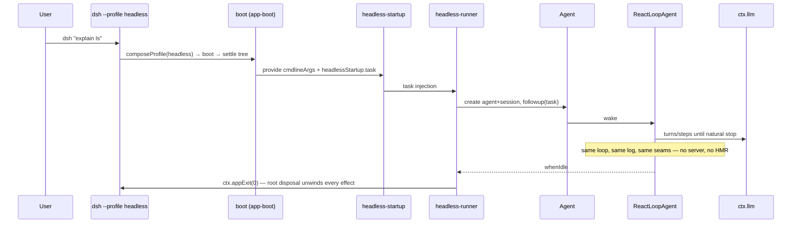
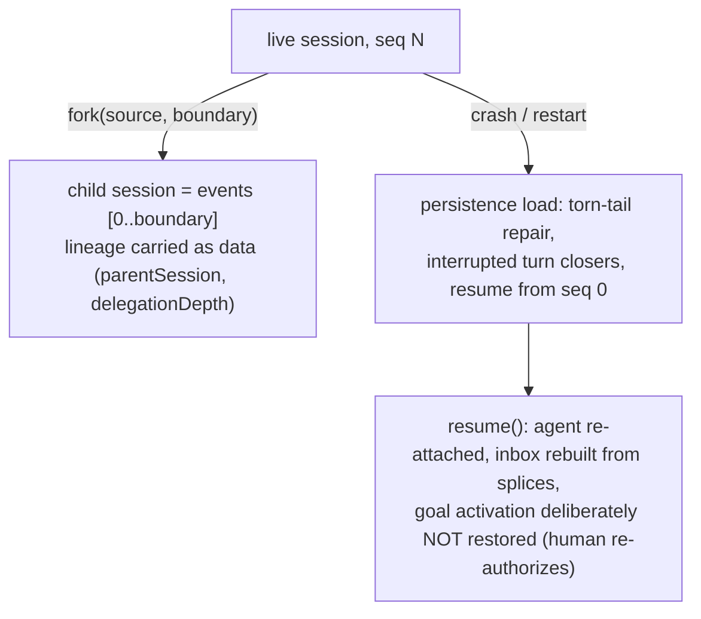

# 13 — End to End: One User Message Through the Whole System

Two traces: the browser app, and the headless CLI. Both converge on the same loop; only the entry and exit differ.

## Trace 1 — Web app: "list files in /tmp"

```mermaid
sequenceDiagram
    participant U as User (browser)
    participant UI as ui-conversation (React)
    participant RT as client runtime (SessionManager)
    participant CON as Connection (WebApiClient)
    participant WS as Host webserver
    participant AP as apiproxy fetch handler
    participant PB as Session/agent services (host)
    participant AG as Agent
    participant DR as ReactLoopAgent
    participant LLM as ctx.llm
    participant TL as ctx.tools
    participant SH as ctx.shell
    participant SB as ctx.sandbox
    participant SUB as ctx.subprocess
    participant LOG as Session log
    participant PERS as Persistence coordinator
    participant DOWN as WebSocket downlink

    U->>UI: type message, press send
    UI->>RT: session.prompt({text})
    RT->>CON: POST /api session.prompt (RpcId X)
    CON->>WS: HTTP request
    WS->>AP: route /api → fetch handler
    AP->>PB: session.prompt service call
    PB->>AG: agent.followup(UserMessage) — inbox next-turn, wake
    AG->>LOG: agent/inbox/spliced + inserted (durable queue facts)
    AG->>DR: wakeDriver
    DR->>DR: turn(): turn/start
    DR->>DR: claim: one next-turn + whole next-step batch
    DR->>DR: agent/pre-step waterfall → enter(messages)
    DR->>LOG: step/start, user/message
    DR->>DR: assemble prompt (ctx.systemPrompt) + tool schemas (ctx.tools)
    DR->>LLM: agent/request → prepareCall → llm/stream
    LLM-->>DR: chunks (block-start, deltas, block-end, finish)
    DR->>LOG: assistant/chunk*, assistant/message
    Note over DR,TL: model answered with a bash tool call
    DR->>LOG: tool/call bash {command: "ls /tmp"}
    DR->>TL: tools/pre-execute (policy allows) → tools/execute → dispatch body
    TL->>SH: shell.resolve(request) → spec; shell.run(spec)
    SH->>SB: sandboxed? confine(['bash','-c','ls /tmp'], policy)
    SB-->>SH: [bwrap --ro-bind / ... -- bash -c 'ls /tmp']
    SH->>SUB: subprocess.spawn(spec) → tree, collect stdout
    SUB-->>SH: done {exitCode 0, stdout "a b c"}
    SH-->>TL: ShellRunResult
    TL->>LOG: tool/result (terminal card)
    TL-->>DR: tools owe another request → claim next-step → next step
    DR->>LLM: second request with the tool result in history
    LLM-->>DR: final assistant text
    DR->>LOG: assistant/message, step/end
    DR->>LOG: turn/end {reason: completed}
    DR-->>AG: agent/status idle
    LOG->>PERS: session/event → write-behind batch → JSONL file
    LOG->>DOWN: session/event fan-out
    DOWN->>CON: /api/events.mux frame
    CON->>RT: event window update
    RT->>UI: state update → rendered transcript
```

Key cross-cutting facts this trace exercises:

- The queue state (`agent/inbox/*` splices) is itself durable, so the UI replays pending state after a reload.
- The model request was derived **from the log** (`deriveMessages()`), and the invariant asserted it byte-equals the dispatched request.
- The sandbox seam rewrapped the exact argv; the tool body never knew confinement was applied.
- The tool result was committed in model order with `sourceEventSeqs` pointing at its `tool/call`.

## Trace 2 — Headless: one-shot task



## Fork and resume: the log is the contract



## Where to go next

- Change something: [docs/architecture.md](../docs/architecture.md) — the map every `packages/` change must respect.
- Add a capability: [docs/cookbook/adding-a-tool.md](../docs/cookbook/adding-a-tool.md) and [adding-an-llm-adapter.md](../docs/cookbook/adding-an-llm-adapter.md).
- Understand a subsystem's types: the generated pages under [docs/subsystems/](../docs/subsystems/README.md).
- Understand why a decision is what it is: [.agents/notes/](../.agents/notes/README.md) (implemented/ = current authority).
