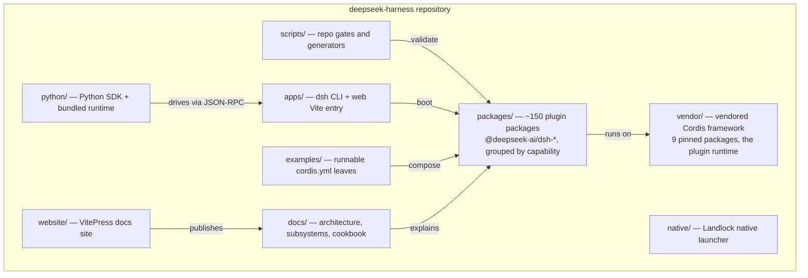
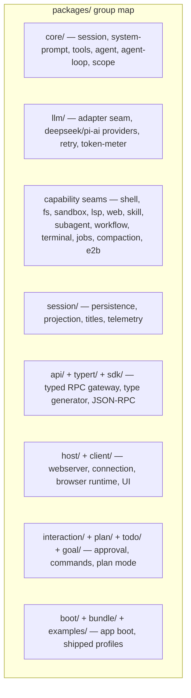

# DeepSeek Harness — Codebase Explained

A diagram-first explanation of the architecture and code. Each page covers one system; every page uses Mermaid diagrams (render on GitHub) with short callouts.

## The repository at a glance

## The one-line model

Everything in dsh is a **Cordis plugin** mounted into a shared context — the model adapter, the tool registry, the session log, even the agent loop itself. Capabilities are exposed through **seams** (Service Definition → Provider → Consumer) so swapping one provider (e.g. local bash → sandboxed bash) re-wires the whole product. The **session log** is the single source of truth for everything the model sees.

## Pages

| Page | Answers |
|---|---|
| [01-big-picture.md](01-big-picture.md) | What the product is; why everything is a plugin; the layered map |
| [02-cordis-foundation.md](02-cordis-foundation.md) | Context, services, events, effects, fibers, isolated realms |
| [03-composition-and-boot.md](03-composition-and-boot.md) | Profiles, bundles, patch layers, and the boot sequence |
| [04-agent-loop.md](04-agent-loop.md) | The turn/step driver, inbox semantics, cancellation |
| [05-session-log.md](05-session-log.md) | The durable event log, surface projection, persistence |
| [06-scope-and-tools.md](06-scope-and-tools.md) | Scoped registrations, shadowing, the tool execution pipeline |
| [07-capability-seams.md](07-capability-seams.md) | The 3-role seam pattern; the shell seam end-to-end; sandboxing |
| [08-event-system.md](08-event-system.md) | Event domains, dispatch modes, waterfall contracts |
| [09-llm-layer.md](09-llm-layer.md) | Message vocabulary, the adapter seam, streaming, retry |
| [10-web-api-and-rpc.md](10-web-api-and-rpc.md) | Host/client split, Typert codegen, JSON-RPC SDK, ACP |
| [11-session-plumbing.md](11-session-plumbing.md) | Persistence backends, projection cache, telemetry, compaction |
| [12-monorepo-and-build.md](12-monorepo-and-build.md) | Workspace layout, compiler faces, build and gate pipeline |
| [13-end-to-end.md](13-end-to-end.md) | One user message traced through the whole system |

## Reading order

**New to the codebase:** 01 → 03 → 04 → 13 (the core flow), then 02 and 08 for the framework mechanics, then 07 for how capabilities plug in, then 05–06, 09–12 as needed.

**Recommended pairing:** keep `docs/architecture.md` and the generated [event map](../docs/event-producer-consumer.md) open while reading; these pages cite source files with `path:line` so you can jump straight in.

## Conventions used here

- `file:line` references are real source locations (e.g. `packages/core/agent-loop/src/agent.ts:246`).
- Durable session events are written `turn/start`, `assistant/chunk`; live coordination events are written `agent/pre-step`, `tools/execute`.
- The official vocabulary (seam, scope, turn, step, round, goal) matches [docs/glossary.md](../docs/glossary.md).
